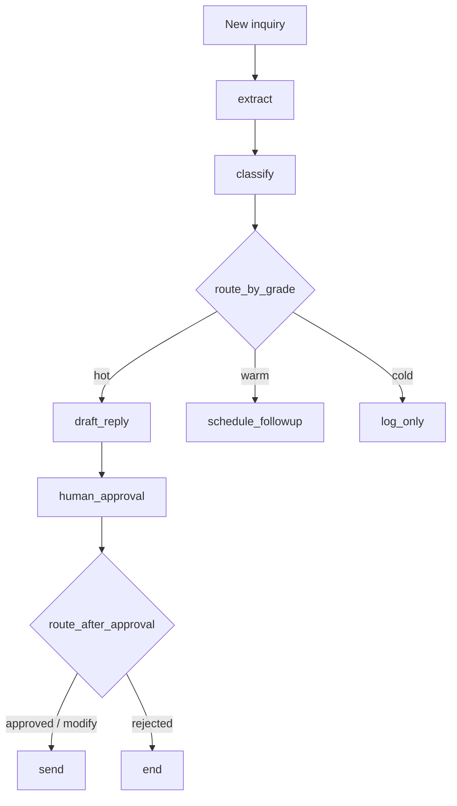

# Lead Triage Agent

An AI agent that reads incoming customer inquiries, extracts the key details, classifies each lead, and routes it to the right next step, with a human approval step before any reply is sent.

Built with **Python, LangGraph, FastAPI, and Langfuse**.

> **Status:** In progress. Core agent, API, tests, and evals are being built this week. See the [roadmap](#roadmap) below.

---

## Why I built this

At my job, I build AI automations for small businesses that receive a steady stream of inquiries by email and web forms. Most of the work is the same every time: read the message, figure out what the customer wants, decide how urgent it is, and write a reply. I originally built this flow with n8n and TypeScript. This project rebuilds it from scratch in Python with LangGraph, so I can compare the two approaches and add proper evaluation and tracing.

All data in this repo is synthetic. It uses a fictional company and sample inquiries.

---

## How it works

Each inquiry runs through a LangGraph state graph. Every node reads and updates a shared `State` (raw message, extracted fields, lead tier, draft reply, approval status).



| Node | What it does |
| --- | --- |
| `extract` | Uses LLM structured output (Pydantic) to pull name, contact, service, budget, and preferred date. Missing fields stay `null` instead of being guessed. |
| `classify` | Labels the lead as hot, warm, or cold, and stores the reason. |
| `route_by_grade` | Conditional edge that picks the next step based on the tier. Pure Python, no LLM call. |
| `draft_reply` | Writes a reply grounded in the company's service information. |
| `schedule_followup` | Placeholder for creating a follow-up task (logs only in this demo). |
| `log_only` | Placeholder for recording a cold lead (logs only in this demo). |
| `human_approval` | Pauses the graph with `interrupt` until a person approves, edits, or rejects the draft. |
| `route_after_approval` | Sends the reply only if it was approved or modified. A rejected draft ends the run. |
| `send` | Marks the approved reply as sent. In this demo it only logs; no email goes out. |

---

## Tech stack

- **Agent:** LangGraph, LangChain, OpenAI API
- **API:** FastAPI (async), Pydantic
- **Persistence:** LangGraph checkpointer (`InMemorySaver`)
- **Observability and evals:** Langfuse tracing (one trace per lead, with prompts, tokens, cost, latency), labeled dataset and custom runner
- **Testing:** pytest, ruff
- **Delivery:** Docker, Docker Compose, GitHub Actions

---

## API

| Method | Endpoint | Description |
| --- | --- | --- |
| `POST` | `/leads` | Submit an inquiry. Runs the graph and returns a `thread_id`. |
| `GET` | `/leads/{thread_id}` | Get the current state, lead tier, and draft reply. |
| `POST` | `/leads/{thread_id}/approve` | Approve, edit, or reject the draft. Resumes the graph. |

Interactive docs are available at `/docs` once the server is running.

Approve request body: `{"action": "approved"}`, `{"action": "modify", "reply_draft": "..."}`, or `{"action": "rejected"}`.

Example request:

```bash
curl -X POST http://localhost:8000/leads \
  -H "Content-Type: application/json" \
  -d '{"raw_text": "Hi, we need a new 6-page website for our bakery. Budget is about $5,000 and we want to launch next month. Email: owner@bakery.example"}'
```

---

## Getting started

```bash
git clone https://github.com/Jiwonhmm/lead-triage-agent.git
cd lead-triage-agent

cp .env.example .env        # add your OPENAI_API_KEY and Langfuse keys

# Option 1: Docker
docker compose up

# Option 2: local (requires uv)
uv sync
uv run uvicorn app.main:app --reload
```

---

## Testing and evaluation

```bash
uv run pytest                          # unit and integration tests (LLM calls are mocked)
uv run python -m evals.run_evals v1    # labeled eval set against the real model (costs a few cents)
```

- **Unit and integration tests** mock the LLM so routing and API behavior are deterministic.
- **Evals** run a labeled set of sample inquiries against the real model and report classification accuracy and field-level extraction accuracy. Scoring rules for each field are defined in [`evals/dataset.json`](evals/dataset.json), and every prompt change is recorded in [`evals/prompt_log.md`](evals/prompt_log.md).

### Results

| Version | Classification accuracy | Extraction accuracy | Notes |
| --- | --- | --- | --- |
| v1 prompt | 100% | 88% | Baseline (20 leads, gpt-4o-mini) |
| v2 prompt | TBD | TBD | After reviewing failures |

---

## Design decisions

- **Human in the loop by default.** An AI should not send a customer-facing message on its own. The graph pauses at `human_approval` and only resumes after a person reviews the draft.
  - In testing, the same inquiry run four times at `temperature=0` produced four different drafts. All followed the reply guidelines, but only two of the four mentioned the booking integration the customer asked for. Wording and coverage vary from run to run, so a person checks each draft before it goes out.
- **Validate before trusting.** LLM output is parsed into Pydantic models with `Literal` types, so a grade or service outside the allowed values fails validation instead of silently routing the lead. API request bodies are validated the same way (invalid input returns 422).
- **Mock for tests, measure with evals.** Unit tests stay fast and deterministic by mocking the model. Model quality is measured separately with a labeled eval set.

---

## Limitations and next steps

- **State lives in memory.** The checkpointer is `InMemorySaver`, so drafts waiting for approval are lost when the server or container restarts, and it only works with a single instance. A production setup would use a persistent checkpointer such as SQLite or Postgres.
- **Approving a finished lead returns 200.** Sending an approval to a thread that is no longer waiting does nothing but still returns success. It should return `409 Conflict`.
- **Checkpoint serialization warning.** LangGraph warns that `ExtractedLead` (a Pydantic model stored in state) is deserialized from the checkpoint without being registered, and says this will be blocked in a future version. Fix: register the type with the checkpoint serializer, or store the extracted fields as a plain dict.
- **No grade for existing customers.** A follow-up such as "I sent a request last week and nobody answered" (lead-020) is graded cold, but a real business should not drop it.
- **Small eval set.** 20 synthetic leads are enough to compare prompt versions, not to claim real-world accuracy.
- **Demo side effects only.** `schedule_followup`, `log_only`, and `send` log to the console; nothing is emailed or stored.

---

## How I built this with Claude Code

I used AI as a pair programmer and reviewer, not as an autopilot. I wrote or read every line myself so I can explain it, and I checked each step by running it before moving on.

**Breaking the work into steps.** I followed a fixed order, one piece at a time: State and schemas → `extract` → `classify` → conditional routing → `draft_reply` → `human_approval` → API → tests and evals. Each step was small enough to run and check on its own before connecting it to the graph.

**Definition of done for each step.** A step was done when it ran from the terminal on four sample leads covering each case (hot, warm, cold spam, empty message) and gave the expected result. For example, routing was done only when each lead reached the right node.

**How I reviewed the output.**
- Every wrong or unstable model output went into [`evals/prompt_log.md`](evals/prompt_log.md) with its cause, instead of being patched right away. Prompts change only after the current version has an eval score, so the before/after comparison is real.
- Unit tests mock the LLM. Model quality is measured separately with the labeled eval set.

**Claude Code setup in this repo.**
- [`CLAUDE.md`](CLAUDE.md): project structure, commands, code rules, and what not to do (for example, never read or commit `.env`, never run paid API calls unless asked, never put side effects before `interrupt()`). Several rules come from real mistakes made while building this.
- [`.claude/commands/test-summary.md`](.claude/commands/test-summary.md): `/test-summary` runs ruff and pytest and summarizes each failure with its likely cause.
- [`.claude/commands/log-prompt-change.md`](.claude/commands/log-prompt-change.md): `/log-prompt-change` records a prompt change in the prompt log in a consistent format.
- [`.claude/settings.json`](.claude/settings.json): a `PostToolUse` hook that runs `ruff format` and `ruff check` after every file edit, so formatting and indentation errors are caught immediately instead of at runtime.

---

## Project structure

```
lead-triage-agent/
├── app/
│   ├── graph.py        # LangGraph graph assembly
│   ├── nodes.py        # extract, classify, draft_reply, etc.
│   ├── state.py        # State definition
│   ├── schemas.py      # Pydantic models
│   ├── prompts.py      # Prompts with version notes
│   └── main.py         # FastAPI endpoints
├── data/
│   ├── company.json      # fictional company config
│   └── sample_leads.json # 20 sample inquiries
├── evals/
│   ├── dataset.json      # expected answers + scoring rules
│   ├── run_evals.py
│   └── prompt_log.md     # every prompt change and why
├── tests/
│   ├── test_routing.py   # router functions
│   ├── test_graph.py     # graph flow with mocked LLMs
│   └── test_api.py       # FastAPI TestClient flow
├── .claude/
│   ├── commands/       # custom slash commands
│   └── settings.json   # hooks
├── .github/workflows/ci.yml
├── Dockerfile
├── docker-compose.yml
├── .env.example
├── CLAUDE.md
└── README.md
```

---

## Roadmap

- [x] LangGraph agent with extract, classify, route, and draft nodes
- [x] Human approval with `interrupt` and checkpoints
- [x] Async FastAPI endpoints
- [x] pytest unit and integration tests
- [x] Labeled eval set and eval runner
- [ ] Langfuse tracing and eval scores
- [x] Docker and GitHub Actions CI
- [ ] Eval results and before/after comparison in this README

---

## Author

**Emma Jiwon Ham** · [LinkedIn](https://www.linkedin.com/in/jiwon-hahm) · [GitHub](https://github.com/Jiwonhmm)
