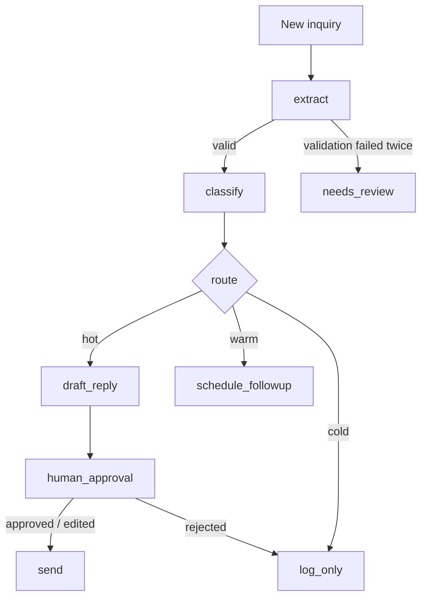

# Lead Triage Agent

An AI agent that reads incoming customer inquiries, extracts the key details, classifies each lead, and routes it to the right next step, with a human approval step before any reply is sent.

Built with **Python, LangGraph, FastAPI, and Langfuse**.

> **Status:** In progress. Core agent, API, tests, and evals are being built this week. See the [roadmap](#roadmap) below.

---

## Why I built this

At my job, I build AI automations for small businesses that receive a steady stream of inquiries by email and web forms. Most of the work is the same every time: read the message, figure out what the customer wants, decide how urgent it is, and write a reply. I originally built this flow with n8n and TypeScript. This project rebuilds it from scratch in Python with LangGraph, so I can compare the two approaches and add proper evaluation and tracing.

All data in this repo is synthetic. It uses a fictional company and sample inquiries.

---

## How it works

Each inquiry runs through a LangGraph state graph. Every node reads and updates a shared `State` (raw message, extracted fields, lead tier, draft reply, approval status).



| Node | What it does |
| --- | --- |
| `extract` | Uses LLM structured output (Pydantic) to pull name, contact, service, budget, and preferred date. Retries once if validation fails, then sends the lead to human review. |
| `classify` | Labels the lead as hot, warm, or cold, and stores the reason. |
| `route` | Conditional edge that picks the next step based on the tier. |
| `draft_reply` | Writes a reply grounded in the company's service information. |
| `schedule_followup` | Creates a follow-up task instead of replying right away. |
| `human_approval` | Pauses the graph with `interrupt` until a person approves, edits, or rejects the draft. |
| `send` | Marks the approved reply as sent. In this demo, it is recorded in the database instead of emailed. |

---

## Tech stack

- **Agent:** LangGraph, LangChain, OpenAI API
- **API:** FastAPI (async), Pydantic
- **Persistence:** LangGraph checkpointer (SQLite)
- **Observability and evals:** Langfuse
- **Testing:** pytest, ruff
- **Delivery:** Docker, Docker Compose, GitHub Actions

---

## API

| Method | Endpoint | Description |
| --- | --- | --- |
| `POST` | `/leads` | Submit an inquiry. Runs the graph and returns a `thread_id`. |
| `GET` | `/leads/{thread_id}` | Get the current state, lead tier, and draft reply. |
| `POST` | `/leads/{thread_id}/approve` | Approve, edit, or reject the draft. Resumes the graph. |

Interactive docs are available at `/docs` once the server is running.

Example request:

```bash
curl -X POST http://localhost:8000/leads \
  -H "Content-Type: application/json" \
  -d '{"message": "Hi, we need a quote for a kitchen renovation next month. Budget is around $20k."}'
```

---

## Getting started

```bash
git clone https://github.com/Jiwonhmm/lead-triage-agent.git
cd lead-triage-agent

cp .env.example .env        # add your OPENAI_API_KEY and Langfuse keys

# Option 1: Docker
docker compose up

# Option 2: local
python -m venv .venv && source .venv/bin/activate
pip install -r requirements.txt
uvicorn app.main:app --reload
```

---

## Testing and evaluation

```bash
pytest                      # unit and integration tests (LLM calls are mocked)
python evals/run_evals.py   # runs the labeled eval set against the real model
```

- **Unit and integration tests** mock the LLM so routing and API behavior are deterministic.
- **Evals** run a labeled set of sample inquiries against the real model and report classification accuracy and field-level extraction accuracy. Results and traces are logged to Langfuse.

### Results

| Version | Classification accuracy | Extraction accuracy | Notes |
| --- | --- | --- | --- |
| v1 prompt | TBD | TBD | Baseline |
| v2 prompt | TBD | TBD | After reviewing failures |

---

## Design decisions

- **Human in the loop by default.** An AI should not send a customer-facing message on its own. The graph pauses at `human_approval` and only resumes after a person reviews the draft.
- **Validate before trusting.** Extracted data is checked against a Pydantic schema. Failed extractions are retried once, then routed to human review instead of guessing.
- **Mock for tests, measure with evals.** Unit tests stay fast and deterministic by mocking the model. Model quality is measured separately with a labeled eval set.

---

## Project structure

```
lead-triage-agent/
├── app/
│   ├── graph.py        # LangGraph graph assembly
│   ├── nodes.py        # extract, classify, draft_reply, etc.
│   ├── state.py        # State definition
│   ├── schemas.py      # Pydantic models
│   ├── prompts.py      # Prompts with version notes
│   └── main.py         # FastAPI endpoints
├── data/
│   └── sample_leads.json
├── evals/
│   ├── dataset.json
│   └── run_evals.py
├── tests/
│   ├── test_routing.py
│   └── test_api.py
├── .github/workflows/ci.yml
├── Dockerfile
├── docker-compose.yml
├── .env.example
└── README.md
```

---

## Roadmap

- [ ] LangGraph agent with extract, classify, route, and draft nodes
- [ ] Human approval with `interrupt` and checkpoints
- [ ] Async FastAPI endpoints
- [ ] pytest unit and integration tests
- [ ] Labeled eval set and eval runner
- [ ] Langfuse tracing and eval scores
- [ ] Docker and GitHub Actions CI
- [ ] Eval results and before/after comparison in this README

---

## Author

**Emma Jiwon Ham** · [LinkedIn](https://www.linkedin.com/in/jiwon-hahm) · [GitHub](https://github.com/Jiwonhmm)
